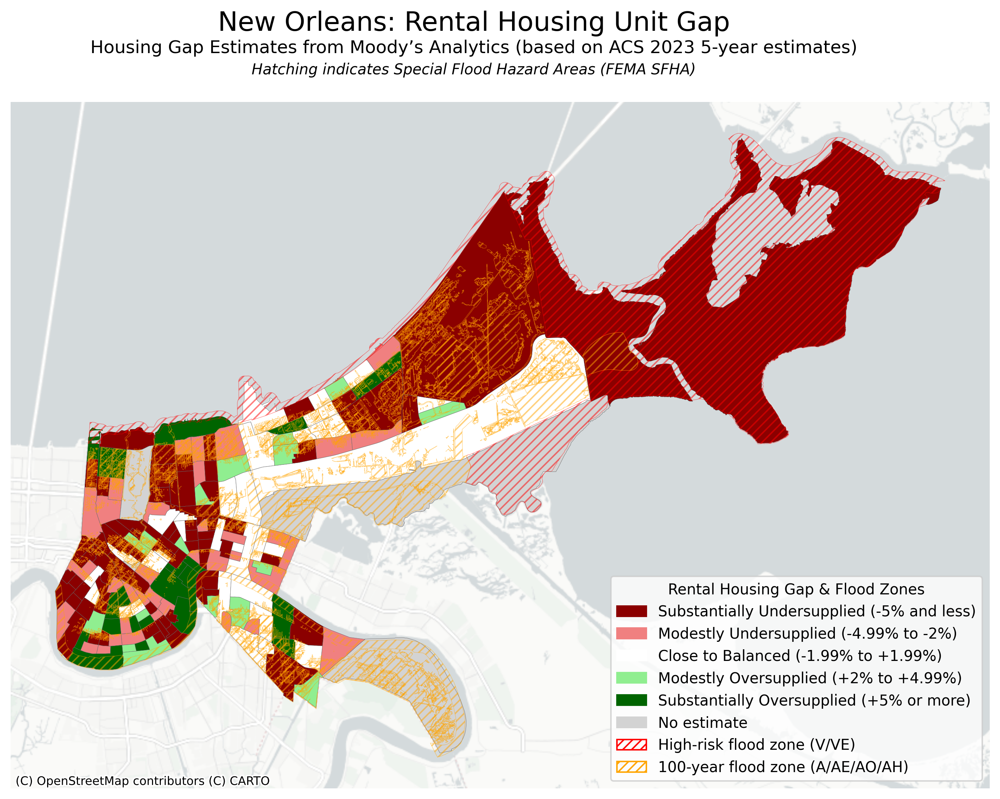

# Airbnbs & Gentrification in New Orleans

**Live project:** https://sinamayer.github.io/nola_airbnb/

How do short-term rentals relate to housing affordability, rental housing gaps and flood risk across New Orleans neighborhoods? This project maps Airbnb activity at the census-tract level and overlays it with income, rental housing supply, FEMA flood zones and public transit access.

*Final project for Command-Line GIS, Edward J. Bloustein School of Planning and Public Policy, Rutgers University (Fall 2025).*


## What's in it

- **Affordability map:** median nightly Airbnb price relative to median daily household income by census tract, with circles sized by Airbnb density. Tracts with unreliable income estimates (high coefficient of variation) are flagged.
- **Housing gap & flood risk map:** rental housing unit gap overlaid with FEMA Special Flood Hazard Areas.
- **Interactive webmap:** affordability choropleth, clustered Airbnb listings, a listing heat map, flood zones, quarter-mile transit buffers, and RTA routes and stops.



## Data

| Data | Source |
|---|---|
| Airbnb listings | Inside Airbnb |
| Census tract boundaries | NHGIS |
| Median household income | ACS 2023 5-year estimates |
| Rental housing gap | Moody's Analytics, Reinvestment Fund, PolicyMap |
| Flood zones | FEMA National Flood Hazard Layer |
| Transit routes and stops | City of New Orleans, data.gov |

## Methods

All processing and mapping is in [`nola_airbnb_analysis.ipynb`](nola_airbnb_analysis.ipynb) (Python: geopandas, pandas, matplotlib, contextily, folium, Census API).

1. **Spatial join:** projected listings and tracts to Louisiana State Plane (EPSG:3452) and joined each listing to its census tract.
2. **Aggregation:** computed Airbnb counts and median nightly price per tract.
3. **Affordability ratio:** pulled median household income (ACS 2023 5-year) from the Census API, converted it to daily income, and divided the median nightly price by it.
4. **Reliability:** derived a coefficient of variation from the ACS margins of error and hatched tracts with CV > 40 as low reliability.
5. **Flood risk:** filtered FEMA Special Flood Hazard Areas into V/VE (coastal) and A-type (100-year) zones, then dissolved and simplified them for mapping.
6. **Transit access:** built quarter-mile buffers around RTA stops.
7. **Maps:** static maps in matplotlib with CartoDB basemaps; interactive webmap in Folium with toggleable layers.

### Run it yourself

```bash
pip install -r requirements.txt
```

Download the raw data listed above into a `data/` folder (not included in the repo), optionally set a free Census API key as `CENSUS_API_KEY`, and run the notebook. It also runs in Google Colab.

## Limitations

- Some tracts have missing or low-confidence income and rental gap estimates, so ratios there should be read with caution.
- The FEMA flood layer was last updated in 2016.
- Airbnb listings are a snapshot and do not capture how often units are actually booked.

## Repository structure

```
nola_airbnb_analysis.ipynb       full analysis and map-making code
requirements.txt                 Python dependencies
index.md                         project write-up (the GitHub Pages site)
nola_Airbnbs.html                interactive webmap
airbnb_affordability_map.png     static map 1
airbnb_housinggap_map.png        static map 2
```

## Author

**Sina-Marie Mayer** · [Portfolio](https://sinamayer.github.io) · [GitHub](https://github.com/sinamayer)
